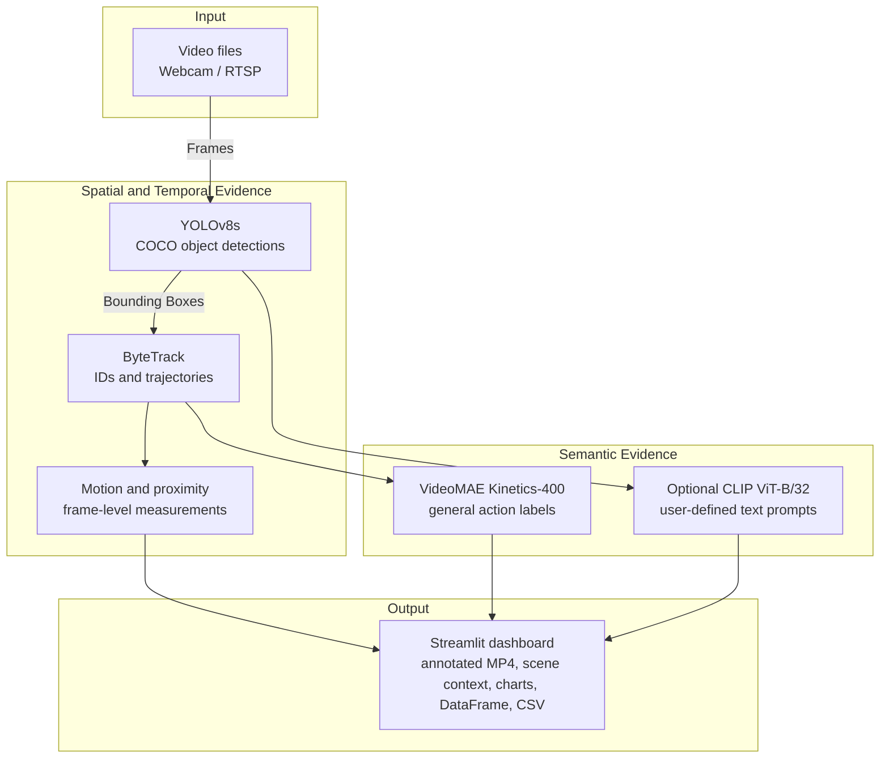

<h1 align="center">Open-World Video Intelligence</h1>

<p align="center">
  <strong>Evidence-focused video analysis with temporal, spatial, and open-vocabulary signals</strong>
</p>

<p align="center">
  <a href="#"></a>
  <a href="#"></a>
  <a href="#"></a>
  <a href="#"></a>
  <a href="#"></a>
</p>

---

## Architecture



## Key Features

| Feature | Description |
|---------|-------------|
| **YOLOv8s + ByteTrack** | Detects COCO objects, tracks IDs, and provides spatial/motion evidence. |
| **VideoMAE Kinetics-400** | Produces pretrained general-action labels for temporal clips; it is not an anomaly classifier. |
| **Optional CLIP ViT-B/32** | Ranks custom natural-language event descriptions against sampled frames. Model inference runs locally after weights are available. |
| **Annotated MP4** | Runs detection and tracking on every frame and provides a playable, downloadable video. Audio is not retained. |
| **Video DataFrame** | Summarizes sampled timestamps, object counts, tracks, people proximity, motion, and optional prompt matches; export as CSV. |
| **Scene context** | Infers a broad setting such as road/traffic from detected objects; it does not identify a physical address. |
| **Evidence previews** | Displays the annotated video and selected sampled frames alongside time-series charts. |
| **Multiple input paths** | Upload a video, analyze a project video, or use webcam/RTSP live monitoring. |

## Important limitations

- CLIP compares frames with the descriptions supplied by the user. It cannot
  discover an event outside that candidate set, and its relative scores are not
  calibrated probabilities.
- VideoMAE's Kinetics-400 labels describe common actions; they do not prove an
  incident or provide a UCF-Crime anomaly score.
- Pixel speed and image-space proximity are not real-world measurements.
- The annotated video processes every frame and can take several minutes on CPU.
- Scene context is a visual inference from detected objects, not GPS or a verified
  event location.
- Treat model outputs as review cues and verify them against the displayed
  frame evidence. The archived benchmark files are not a performance guarantee
  for the models used by this application.

## Quick Start

### Installation

```bash
# Clone the repository
git clone https://github.com/Pari2003/Real-Time-Video-Anomaly-Detection.git
cd Real-Time-Video-Anomaly-Detection

# Create virtual environment
python -m venv venv
source venv/bin/activate  # Linux/Mac
# venv\Scripts\activate   # Windows

# Install dependencies
pip install -r requirements.txt
```

### Run on Webcam

```bash
python -m src.pipeline --source 0
```

### Run on Video File

```bash
python -m src.pipeline --source path/to/surveillance_video.mp4
```

### Run on RTSP Stream

```bash
python -m src.pipeline --source "rtsp://camera.local/stream1"
```

### Launch Dashboard

```bash
streamlit run dashboard/app.py
```

Choose **Webcam**, select the camera index, and click **Start Webcam** to view
frames processed by the pipeline. The webcam must be connected to the machine
running Streamlit; click **Stop Webcam** to release it.

To process a camera stream in the dashboard, choose **RTSP Stream**, enter a
reachable `rtsp://` URL, and click **Start Live Stream**. Click **Stop Live
Stream** to disconnect.

### Run with Docker

```bash
docker build -t anomaly-detector .
docker run --gpus all -p 8501:8501 anomaly-detector
```

## Project Structure

```
├── src/
│   ├── detector.py           # YOLOv8 object detection wrapper
│   ├── tracker.py            # ByteTrack multi-object tracker
│   ├── anomaly_classifier.py # VideoMAE anomaly classification + MIL
│   ├── pipeline.py           # End-to-end pipeline orchestrator
│   ├── video_io.py           # Async video I/O (webcam, RTSP, files)
│   ├── heatmap.py            # Grad-CAM heatmaps & visualization
│   └── utils.py              # FPS counter, config, latency tracking
├── optimization/
│   ├── export_onnx.py        # YOLOv8 -> ONNX export
│   ├── benchmark.py          # Latency benchmark suite
│   └── quantize.py           # FP16/INT8 quantization
├── evaluation/
│   ├── evaluate_ucf_crime.py # UCF-Crime benchmark evaluation
│   ├── compute_metrics.py    # ROC-AUC, AP, EER computation
│   └── plot_results.py       # Publication-quality plots
├── dashboard/
│   └── app.py                # Streamlit real-time monitoring UI
├── configs/
│   ├── default.yaml          # Master configuration
│   ├── bytetrack.yaml        # Tracker configuration
│   └── inference.yaml        # Optimization settings
├── tests/                    # Unit tests
├── results/                  # Benchmark tables, ROC curves, metrics
├── Dockerfile                # Docker deployment
└── .github/workflows/ci.yml  # CI/CD pipeline
```

## Configuration

All pipeline parameters are managed via YAML configs in `configs/`:

```yaml
# configs/default.yaml
detector:
  model: "yolov8s.pt"
  conf_threshold: 0.25
  half: true            # FP16 inference

anomaly:
  model_name: "MCG-NJU/videomae-base"
  clip_length: 16       # Frames per classification window
  anomaly_threshold: 0.65

tracker:
  track_buffer: 30      # Lost track retention (frames)
  match_threshold: 0.8  # ByteTrack IoU threshold
```

## Optimization

### ONNX Export

```bash
python optimization/export_onnx.py --model yolov8s.pt --half --output weights/yolov8s.onnx
```

### Run Benchmarks

```bash
python optimization/benchmark.py --pytorch-model yolov8s.pt --onnx-model weights/yolov8s.onnx
```

### Quantization

```bash
# FP16 quantization
python optimization/quantize.py --input weights/yolov8s.onnx --precision fp16

# Dynamic INT8 quantization
python optimization/quantize.py --input weights/yolov8s.onnx --precision int8-dynamic
```

## Evaluation

### Run UCF-Crime Evaluation

```bash
python evaluation/evaluate_ucf_crime.py --dataset-path data/UCF-Crime/ --output-dir results/
```

### Generate Plots

```bash
python evaluation/plot_results.py --results results/metrics.json
```

## Testing

```bash
# Run all tests
python -m pytest tests/ -v

# Run with coverage
python -m pytest tests/ -v --cov=src --cov-report=term-missing
```

## Design Decisions

| Decision | Rationale |
|----------|-----------|
| **YOLOv8 over YOLOv5** | Native ByteTrack integration, better mAP/latency tradeoff |
| **ByteTrack over DeepSORT** | Handles low-confidence detections, no Re-ID network overhead |
| **VideoMAE over I3D** | Superior temporal representation, pre-trained on video data |
| **MIL over supervised** | UCF-Crime only has video-level labels, MIL handles this naturally |
| **ONNX over TensorRT** | Portable across hardware; TensorRT supported as optional upgrade |
| **Sliding window** | Enables continuous scoring without waiting for clip boundaries |

## References

- [YOLOv8](https://github.com/ultralytics/ultralytics) - Ultralytics Object Detection
- [ByteTrack](https://arxiv.org/abs/2110.06864) - Multi-Object Tracking by Associating Every Detection Box
- [VideoMAE](https://arxiv.org/abs/2203.12602) - Masked Autoencoders are Data-Efficient Learners for Self-Supervised Video Pre-Training
- [UCF-Crime](https://www.crcv.ucf.edu/research/real-world-anomaly-detection-in-surveillance-videos/) - Real-World Anomaly Detection in Surveillance Videos

## License

This project is licensed under the MIT License - see the [LICENSE](LICENSE) file for details.
